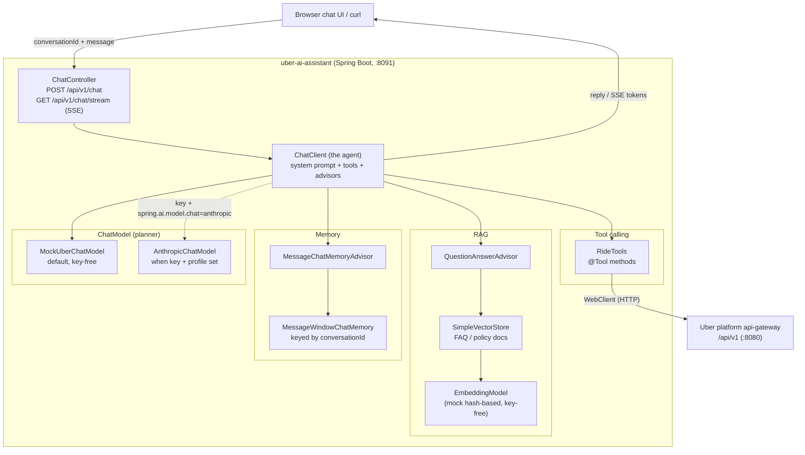
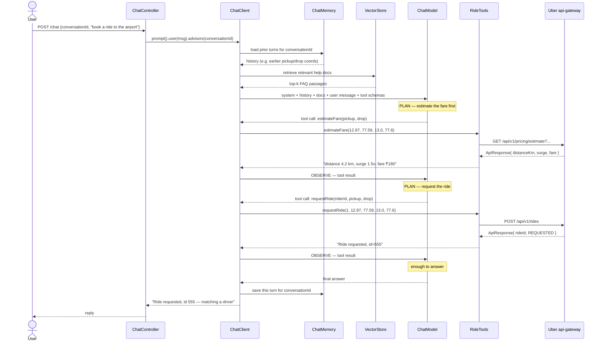

# Diagrams

Architecture and flow diagrams for the Uber AI Assistant.

## 1. High-Level Design (HLD)

How a chat request flows through the agent: the `ChatClient` orchestrates tools (which call the
Uber platform APIs), the RAG vector store, conversation memory, and the underlying `ChatModel`
(mock or real).

## 2. One agentic turn (sequence)

A single request — *"book a ride to the airport"* — showing the plan → act → observe loop: the LLM
plans, calls `estimateFare`, observes, then calls `requestRide`, and returns a final answer. (Shown
with the real LLM doing the planning; the mock follows the same tool-calling path via deterministic
intent matching.)

